# FOC Gimbal Controller

**Single-axis BLDC gimbal stabilizer running voltage-mode Field Oriented Control on an STM32F407, with a custom KiCad driver board.**

[](https://www.st.com/en/microcontrollers-microprocessors/stm32f407vg.html)
[](firmware/)
[](firmware/final_controller.uvprojx)
[](hardware/kicad/)
[](LICENSE)

🇹🇷 [Türkçe README](README.tr.md) · 📄 [Full thesis report (PDF, Turkish)](docs/final_raporu.pdf)

<p align="center">
  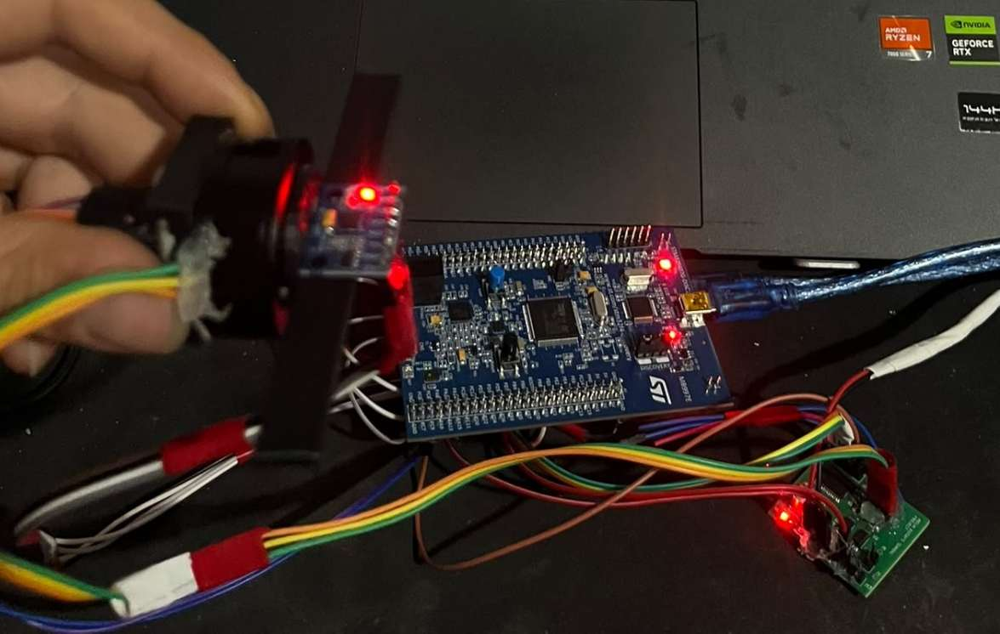
  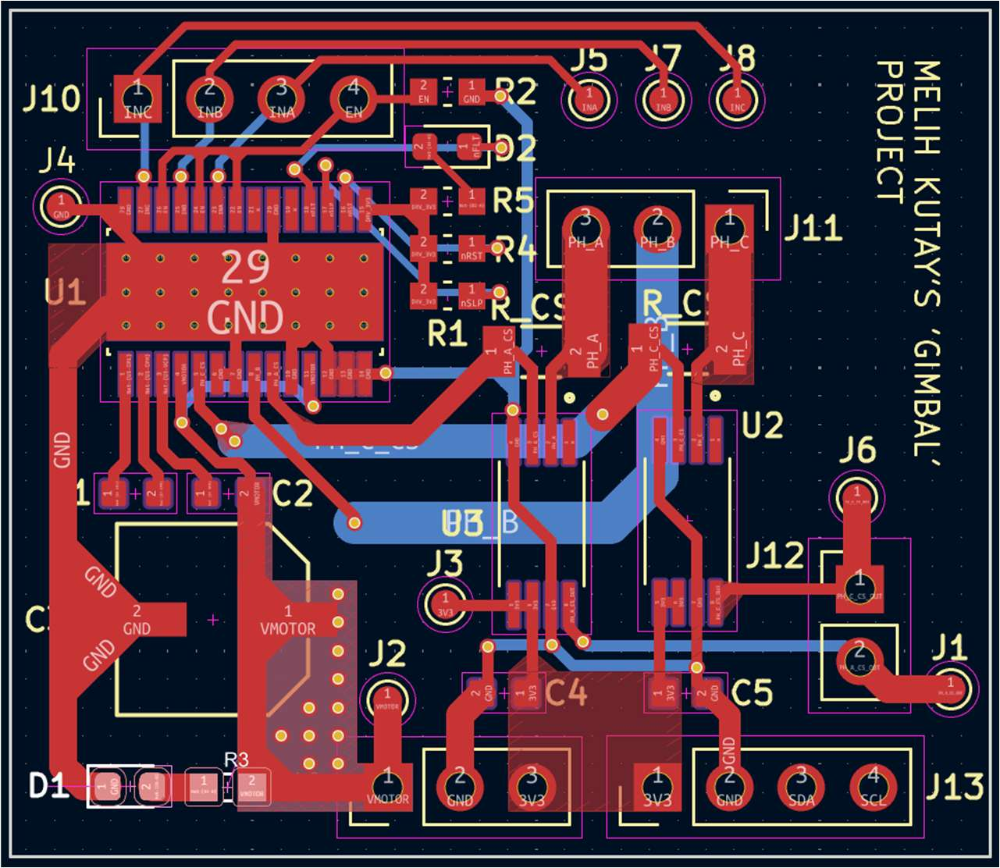
</p>

This repository contains the firmware, PCB design and report of my B.Sc. graduation project at **İstanbul Arel University, Electrical & Electronics Engineering** (2026). The system keeps a platform level against external disturbances. An MPU6050 IMU measures the platform angle, an AS5600 magnetic encoder tracks the rotor, and a PID loop drives a gimbal BLDC motor through FOC and SVPWM. The whole loop runs at 1 kHz on bare-metal STM32 register code.

---

## Highlights

| | |
|---|---|
| **Control loop** | 1 kHz, deterministic, timed with the DWT cycle counter |
| **Loop execution time** | typical 320–350 µs, worst case ~420 µs (**< 42 % CPU**, ≥ 580 µs slack) |
| **Motor control** | Voltage-mode FOC: inverse Park → inverse Clarke → midpoint-clamp SVPWM |
| **PWM** | TIM1 center-aligned, 3-phase, **20 kHz** (ARR = 4200 @ 168 MHz) |
| **State estimation** | Complementary filter (τ = 100 ms, α recomputed from the measured dt every cycle) |
| **Steady-state accuracy** | about **±1.5°** around the reference, motor voltage 0.02–0.20 V at rest |
| **Firmware style** | Bare-metal CMSIS register access, no ST HAL/CubeMX, FPU enabled, DMA UART |
| **Hardware** | Custom 2-layer DRV8313 driver board designed in KiCad and assembled by hand |
| **Robustness** | Error codes with severity levels, I²C bus recovery, anti-windup, locked-rotor and angle-limit protection |

---

## System Architecture

<p align="center">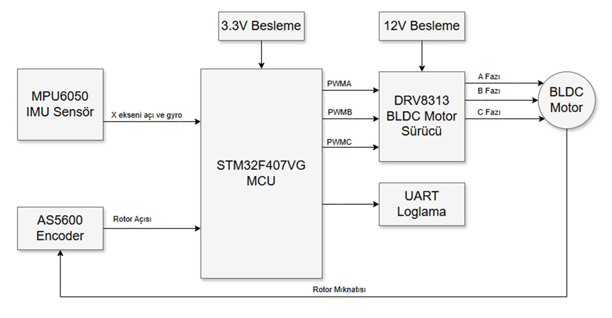</p>

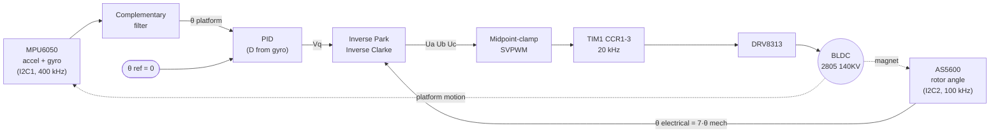

The control stack has two layers:

1. **Outer loop (PID).** It compares the fused platform angle with the reference and outputs a q-axis voltage command `Vq`.
2. **Inner layer (voltage-mode FOC).** It turns `Vq` (with `Vd = 0`) and the electrical rotor angle into three phase voltages, then into PWM duty cycles.

No phase-current feedback is used. The motor torque is set indirectly through the applied voltage, which works well for the low, predictable load torque of a gimbal ([why](#known-limitations--future-work)).

<details>
<summary><b>1 kHz control-loop sequence</b></summary>
<p align="center">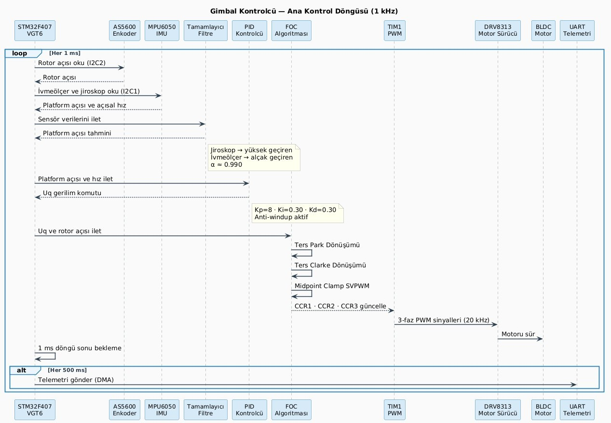</p>
</details>

---

## Hardware

### System components

| Component | Part | Role |
|---|---|---|
| MCU | **STM32F407VGT6** (STM32F4-Discovery) | Cortex-M4F @ 168 MHz, FPU, TIM1 advanced timer, DMA |
| IMU | **MPU6050** | 3-axis accelerometer + gyroscope, platform angle |
| Rotor encoder | **AS5600** | 12-bit contactless magnetic angle sensor |
| Motor | **Flycat 2805 140KV** | Gimbal BLDC, 14 poles (7 pole pairs), 12 V |
| Motor driver | **DRV8313PWP** | 3-phase integrated half-bridge driver (on custom board) |
| Current sense (rev1, inactive) | **INA240A2** + inline shunts | Phase A/C current measurement, see limitations |
| Mechanics | 3D-printed parts | Encoder magnet holder and sensor mounts |

### Custom controller board

I designed the driver board in **KiCad**. It combines the DRV8313 power stage, the inline current-sense channels, the AS5600 connector, test points for the PWM signals, and separate 12 V motor and 3.3 V logic supplies.

<p align="center">
  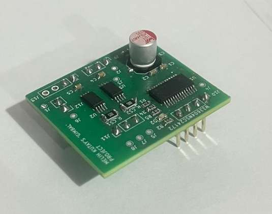
  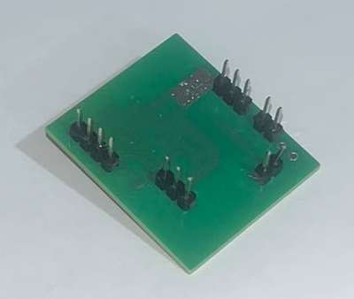
</p>

<details>
<summary><b>Schematic</b></summary>
<p align="center">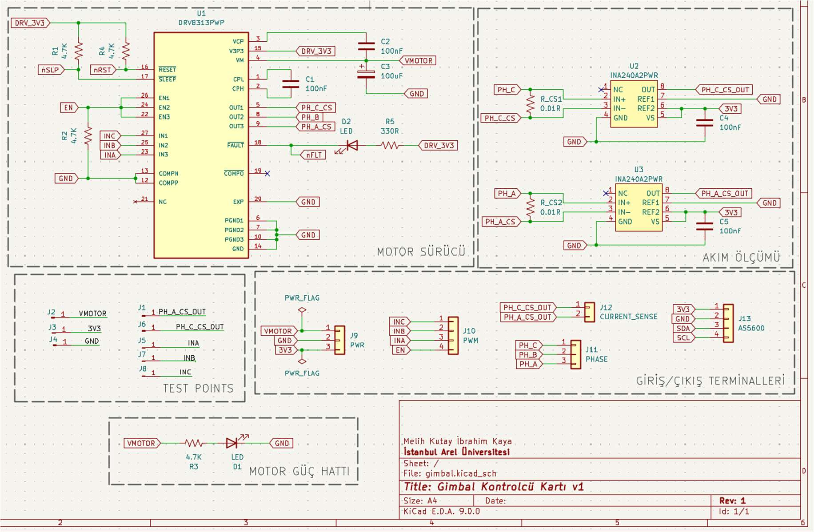</p>
</details>

| Connector | Signals |
|---|---|
| J9 `PWR` | VMOTOR (12 V), GND, 3V3 |
| J10 `PWM` | INC, INB, INA, EN (from STM32 TIM1 / GPIO) |
| J11 `PHASE` | PH_A, PH_B, PH_C (to motor) |
| J12 `CURRENT_SENSE` | INA240 outputs, phase A / C |
| J13 `AS5600` | 3V3, GND, SDA, SCL |
| J1–J8 | Test points (PWM inputs, current-sense outputs, rails) |

- KiCad project: [`hardware/kicad/`](hardware/kicad/), self-contained with symbols, footprints and 3D models under `libs/`

### STM32 pin map

| Function | Peripheral | Pins |
|---|---|---|
| Phase PWM A / B / C | TIM1 CH1 / CH2 / CH3 (AF1) | PE9 / PE11 / PE13 |
| DRV8313 enable | GPIO out | PC9 |
| MPU6050 | I2C1 @ 400 kHz | PB6 (SCL), PB7 (SDA) |
| AS5600 | I2C2 @ 100 kHz | PB10 (SCL), PB11 (SDA) |
| Telemetry / tuning | USART2 @ 115200 8N1, TX via DMA1 Stream6 | PA2 (TX), PA3 (RX) |
| Motor on/off | User button | PA0 |

---

## Firmware

The firmware is written directly against CMSIS register definitions (`stm32f4xx.h`), with no vendor HAL. Every peripheral (clock tree, TIM1, I²C, USART + DMA) is configured by hand.

```
firmware/
├── Src/
│   ├── main.c            # start-up procedure + 1 kHz control loop, PID, safety logic, telemetry
│   ├── foc_math.c        # inverse Park, inverse Clarke, SVPWM midpoint clamp
│   ├── foc_core.c        # FOC_SetPhaseVoltage(): Uq/Ud + θe → phase voltages
│   ├── motor_driver.c    # phase voltages → TIM1 CCR duty cycles (DRV8313, 3-PWM)
│   ├── hardware_hal.c    # register-level drivers: 168 MHz PLL, TIM1, I2C1/2, USART2+DMA, GPIO
│   ├── system_errors.c   # error codes, severity handling, error log, safe shutdown
│   └── autotune.c        # experimental step-response system identification (not enabled)
├── Inc/                  # matching headers (+ current_sense.h, kept from the current-loop design)
├── RTE/                  # CMSIS device startup and system files
└── final_controller.uvprojx
```

### Control algorithm

**Sensor fusion.** A complementary filter combines the integrated gyro rate with the accelerometer tilt angle:

```
θ = α · (θ + ω_gyro · dt) + (1 − α) · atan2(a_y, a_z),    α = τ / (τ + dt),  τ = 100 ms
```

`α` is recomputed from the measured `dt` in every cycle, so loop jitter does not change the filter's time constant.

**PID → Vq.** The PID output is used directly as the q-axis voltage:

```
Vq = dir · ( Kp·e + Ki·∫e dt + Kd·(−ω_gyro) )
```

- The **D term uses the gyro rate directly** instead of differentiating the angle error. This gives no lag and does not amplify noise.
- **Anti-windup:** the integral is clamped so that its contribution never exceeds ±0.5 V.
- The output is clamped to **±6.9 V**.

**Final tuning** (found experimentally with live UART tuning):

| Kp | Ki | Kd | dir | Integral limit | Voltage limit |
|---|---|---|---|---|---|
| 8.0 | 0.30 | 0.30 | −1.0 | ±1.67 rad·s (0.5 V / Ki) | ±6.9 V |

**FOC + SVPWM.** `θe = pole_pairs · θ_mech`. Then `(Vd=0, Vq)` → inverse Park → `(Vα, Vβ)` → inverse Clarke → `(Ua, Ub, Uc)` → midpoint clamp (shifts all phases to centre them in the supply range, giving SVPWM-equivalent bus utilisation) → TIM1 CCR registers. TIM1 updates the duty cycles only at the end of a PWM period, so they never change in the middle of a period.

<p align="center">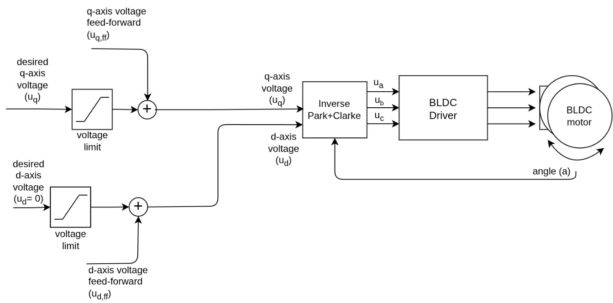</p>

### Start-up procedure

1. **AS5600 health check.** Reads `STATUS` (MD / ML / MH magnet bits) and `AGC`. If no magnet is detected, the error is critical and the system stops.
2. **MPU6050 configuration.** Wakes the sensor, sets DLPF to 42 Hz and the gyro range to ±2000 °/s.
3. **D-axis alignment.** Applies `Ud = 8 V, Uq = 0` for 1 s to lock the rotor on the d-axis, then stores the encoder reading as the electrical zero.
4. **Gyro DC-offset calibration.** Averages the first 500 gyro samples (0.5 s) inside the loop. Motor output stays suppressed until this finishes.
5. **Bumpless start.** The platform angle is seeded from the accelerometer, so the motor does not jerk when it switches on.

<p align="center">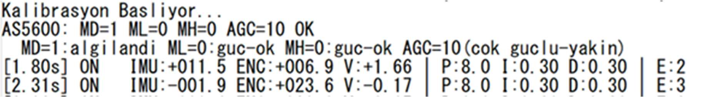</p>

### Fault handling & safety

Errors have 16-bit codes grouped by subsystem. Each code has a severity level that decides the reaction:

| Code | Event | Severity → reaction |
|---|---|---|
| `0x0101` | IMU I²C read failure | **Critical** → gyro rate zeroed, I²C1 reset, safe shutdown, MCU reset and re-calibration |
| `0x0201` | Encoder I²C read failure | Minor → last valid angle held, I²C2 software reset + re-init |
| `0x0202` | No magnet on AS5600 | **Critical** → safe shutdown + MCU reset |
| `0x0301` | Rotor beyond ±170° | Proportional restoring voltage (hysteresis 170°/155°) |
| `0x0302` | Locked rotor (>4 V, <0.05 rad for 500 ms) | Up to 5 recoveries, then motor disabled |
| `0x0303` | Sustained voltage saturation | Logged |
| `0x0401` | Control-loop deadline miss (dt > 20 ms) | Logged |
| `0x0402` | Integral windup | Logged (with hysteresis) |
| `0x0501` | Encoder calibration failure (>100 retries) | **Critical** → safe shutdown + MCU reset |

Critical errors call `Sys_Safe_Shutdown()` (motor driver disabled, PWM zeroed), wait 250 ms so a loose sensor can be reconnected, and then reset the MCU, which runs the start-up calibration again.

The encoder path also uses **outlier rejection**: a jump larger than 0.2 rad within 1 ms is physically impossible, so it is discarded as an EMI spike.

---

## Build & Flash

**Requirements**

- Keil MDK / µVision 5 (ARM Compiler 6)
- `Keil::STM32F4xx_DFP` device pack, which provides the CMSIS core and the STM32F407VGTx startup files
- An ST-LINK (on-board on the STM32F4-Discovery)

**Steps**

1. Open `firmware/final_controller.uvprojx` in µVision.
2. If prompted, install the missing STM32F4xx_DFP pack through Pack Installer.
3. **Build** (F7), then **Download** (F8) to the board.
4. Power the driver board with **12 V** (motor) and **3.3 V** (logic).

> ⚠️ `sensor_direction` and `pid_direction` in `main.c` depend on the phase wiring and the mechanical mounting. If the rotor locks instead of turning, flip `sensor_direction`.

---

## Usage: telemetry & live tuning

Connect a USB-UART adapter to **PA2/PA3** and open a terminal at **115200 8N1**. The status line is printed at 2 Hz:

```
[16.85s] ON   IMU:-000.6 ENC:-023.4 V:-0.19 | P:8.0 I:0.30 D:0.30 | E:3
          │    │          │          │        └─ live PID gains     └─ active error types
          │    │          │          └─ applied Vq (V)
          │    │          └─ rotor mechanical angle (°)
          │    └─ fused platform angle (°)
          └─ CAL / ON / OFF
```

Every 5 s, an error table (code, description, count, last timestamp) is printed when errors exist.

**Live PID tuning without recompiling:**

| Key | Effect | Key | Effect |
|---|---|---|---|
| `q` | Kp + 1 | `a` | Kp − 1 |
| `w` | Ki + 0.1 | `s` | Ki − 0.1 |
| `e` | Kd + 0.1 | `d` | Kd − 0.1 |

The **blue user button (PA0)** toggles the motor on and off.

---

## Results

| Metric | Result |
|---|---|
| Settling after start-up | ≈ 2.8 s (includes D-axis alignment and gyro calibration) |
| Steady-state platform angle | −0.9° … −2.1° (mean ≈ −1.5°), held with 0.02–0.20 V |
| Disturbance rejection | Platform returns to the reference after manual displacements |
| Loop time (DWT) | min ~290 µs · typ 320–350 µs · max ~420 µs of a 1000 µs period |
| PWM verification | 20 kHz, 3-phase symmetry and duty cycles checked with a logic analyzer |

<p align="center">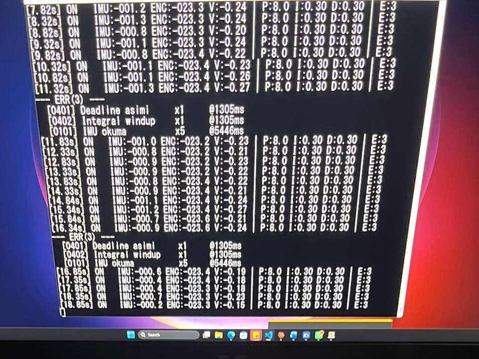</p>

The full test methodology, PID tuning tables (Kp/Ki/Kd sweeps), WCET analysis and EMI discussion are in the [report](docs/final_raporu.pdf) (chapter 4).

---

## Known limitations & future work

- **Current-loop FOC.** The rev1 board includes INA240A2 current-sense channels, but they did not reach the required accuracy, so the design moved to voltage-mode FOC. The next board revision will rework the INA240 reference and differential sensing to enable closed-loop `Id/Iq` control.
- **EMI on I²C.** The sensors were connected with unshielded jumper wires next to 20 kHz phase cables, which caused occasional I²C errors. Those errors are handled in software, but the real fix is a dedicated sensor PCB or harness and possibly a faster or differential interface.
- **Polling I²C.** The AS5600 runs at 100 kHz because of weak pull-ups, and both sensors use polling. Interrupt- or DMA-driven sensor reads would free up loop time.
- **Better sensors**, a **compact integrated board** (MCU on the same PCB), and **multi-axis** (pitch/roll/yaw) extension.

---

## Repository structure

```
.
├── firmware/          Keil µVision project and C sources
├── hardware/
│   └── kicad/         KiCad schematic, PCB and local libraries
├── docs/
│   ├── final_raporu.pdf   Graduation thesis (Turkish)
│   └── images/
├── LICENSE
└── README.md
```

---

## Author

**Melih Kutay İbrahim Kaya**, Electrical & Electronics Engineering, İstanbul Arel University
Supervisor: Assoc. Prof. Dr. Ömer Işık

## License

Released under the [MIT License](LICENSE).
