# FOC Gimbal Kontrolcüsü

**STM32F407 üzerinde gerilim-modlu Alan Yönlendirmeli Kontrol (FOC) ile çalışan, özgün KiCad sürücü kartına sahip tek eksenli BLDC gimbal stabilizatörü.**

[](https://www.st.com/en/microcontrollers-microprocessors/stm32f407vg.html)
[](firmware/)
[](firmware/final_controller.uvprojx)
[](hardware/kicad/)
[](LICENSE)

🇬🇧 [English README](README.md) · 📄 [Bitirme projesi raporu (PDF)](docs/final_raporu.pdf)

<p align="center">
  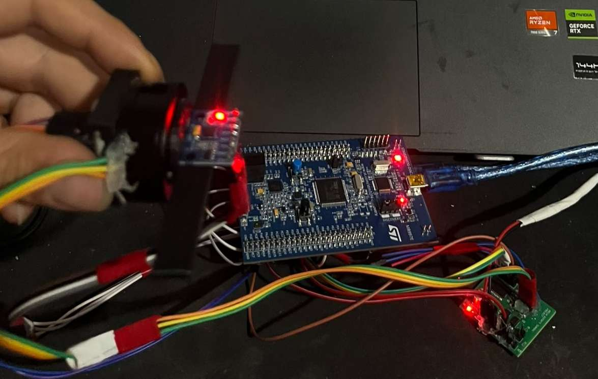
  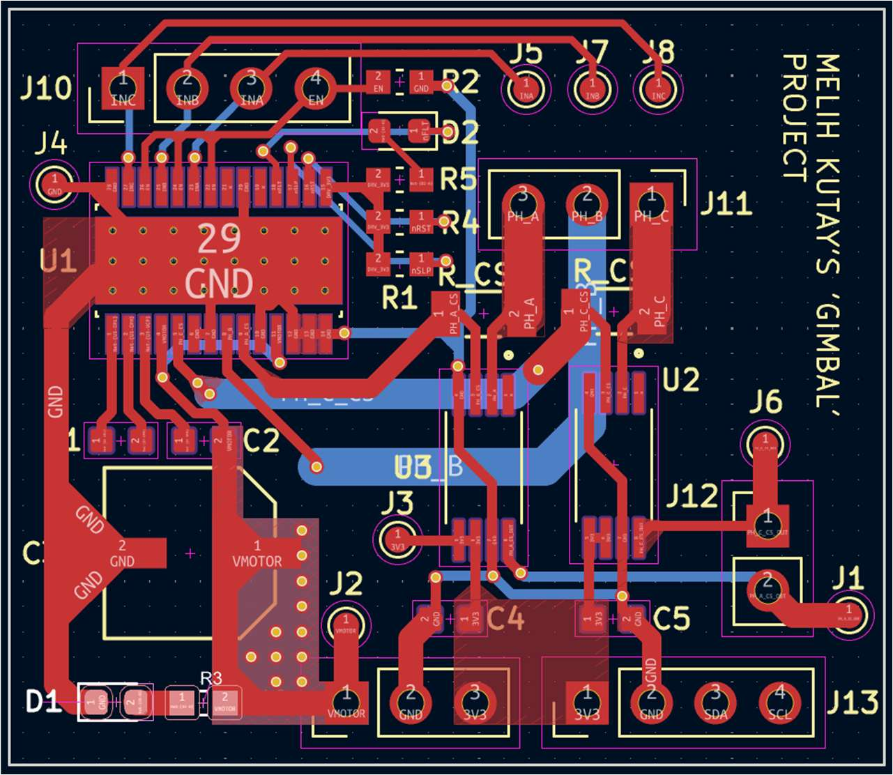
</p>

Bu depo, **İstanbul Arel Üniversitesi Elektrik-Elektronik Mühendisliği** bölümündeki bitirme projemin (2026) yazılımını, kart tasarımını ve raporunu içerir. Sistem, dış bozuculara karşı bir platformu referans açıda tutar. Platform açısı MPU6050 IMU ile ölçülür, rotor konumu AS5600 manyetik enkoder ile takip edilir. PID çevrimi, gimbal BLDC motorunu FOC ve SVPWM üzerinden sürer. Tüm kontrol döngüsü 1 kHz'de, register seviyesinde yazılmış STM32 kodu üzerinde çalışır.

---

## Öne Çıkanlar

| | |
|---|---|
| **Kontrol döngüsü** | 1 kHz, deterministik, DWT çevrim sayacı ile ölçülür |
| **Döngü süresi** | tipik 320–350 µs, en kötü durum ~420 µs (**CPU < %42**, ≥ 580 µs boşluk) |
| **Motor kontrolü** | Gerilim-modlu FOC: ters Park → ters Clarke → midpoint-clamp SVPWM |
| **PWM** | TIM1 merkez hizalı, 3 faz, **20 kHz** (ARR = 4200 @ 168 MHz) |
| **Durum tahmini** | Tamamlayıcı filtre (τ = 100 ms, α her döngüde ölçülen dt'den hesaplanır) |
| **Kararlı durum doğruluğu** | referans etrafında yaklaşık **±1.5°**, durgun hâlde motor gerilimi 0.02–0.20 V |
| **Yazılım yaklaşımı** | ST HAL/CubeMX kullanılmadan, doğrudan CMSIS register erişimi; FPU aktif, UART için DMA |
| **Donanım** | KiCad'de tasarlanıp elle dizilen 2 katmanlı DRV8313 sürücü kartı |
| **Güvenilirlik** | Önem seviyeli hata kodları, I²C hat kurtarma, anti-windup, kilitli rotor ve açı sınırı koruması |

---

## Sistem Mimarisi

<p align="center">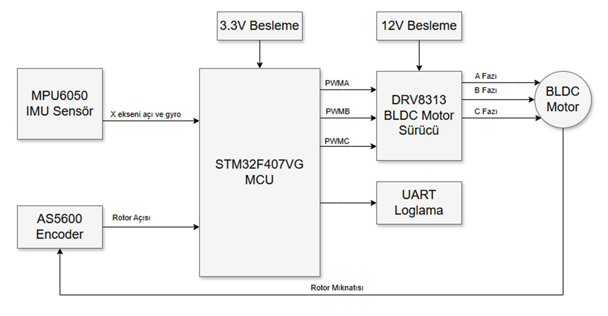</p>

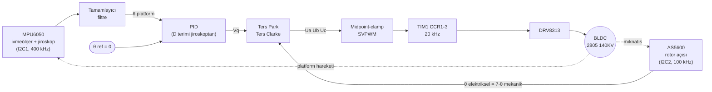

Kontrol yapısı iki katmanlıdır:

1. **Dış çevrim (PID).** Füzyonla elde edilen platform açısını referansla karşılaştırır ve q-ekseni gerilim komutu `Vq` üretir.
2. **İç katman (gerilim-modlu FOC).** `Vq` (`Vd = 0` ile) ve elektriksel rotor açısını üç faz gerilimine, ardından PWM görev oranlarına dönüştürür.

Faz akımı geri beslemesi yoktur. Motor torku uygulanan gerilim üzerinden dolaylı olarak ayarlanır. Bu yaklaşım, gimbalin düşük ve öngörülebilir yük torku için yeterlidir ([neden](#bilinen-kısıtlamalar-ve-gelecek-çalışmalar)).

<details>
<summary><b>1 kHz ana kontrol döngüsü sıralı diyagramı</b></summary>
<p align="center">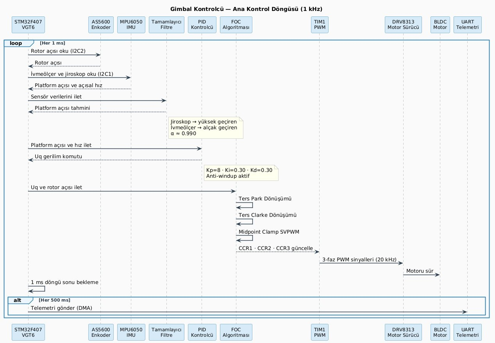</p>
</details>

---

## Donanım

### Sistem bileşenleri

| Bileşen | Parça | Görev |
|---|---|---|
| Mikrodenetleyici | **STM32F407VGT6** (STM32F4-Discovery) | Cortex-M4F @ 168 MHz, FPU, TIM1 gelişmiş zamanlayıcı, DMA |
| IMU | **MPU6050** | 3 eksen ivmeölçer + jiroskop, platform açısı |
| Rotor enkoderi | **AS5600** | 12-bit temassız manyetik açı sensörü |
| Motor | **Flycat 2805 140KV** | Gimbal BLDC, 14 kutup (7 kutup çifti), 12 V |
| Motor sürücü | **DRV8313PWP** | 3 fazlı entegre yarım köprü sürücü (özgün kart üzerinde) |
| Akım algılama (rev1, devre dışı) | **INA240A2** + inline şönt | A/C faz akımı ölçümü, kısıtlamalara bakınız |
| Mekanik | 3B yazıcı parçaları | Enkoder mıknatıs tutucusu ve sensör bağlantıları |

### Özgün kontrolcü kartı

Sürücü kartını **KiCad**'de tasarladım. Kart; DRV8313 güç katını, inline akım algılama kanallarını, AS5600 konnektörünü, PWM sinyalleri için test noktalarını ve birbirinden ayrı 12 V motor ile 3.3 V lojik beslemelerini bir araya getirir.

<p align="center">
  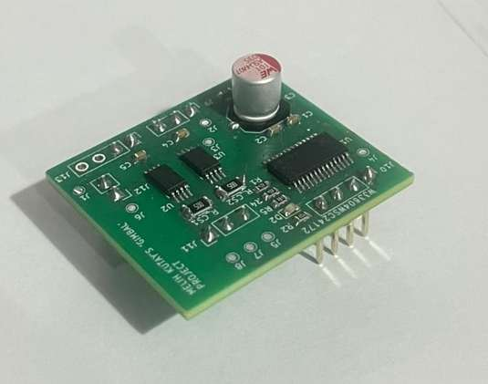
  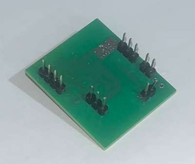
</p>

<details>
<summary><b>Şematik</b></summary>
<p align="center">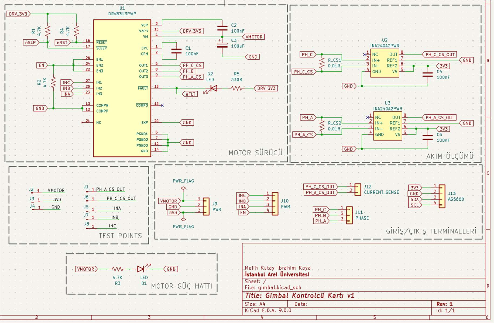</p>
</details>

| Konnektör | Sinyaller |
|---|---|
| J9 `PWR` | VMOTOR (12 V), GND, 3V3 |
| J10 `PWM` | INC, INB, INA, EN (STM32 TIM1 / GPIO'dan) |
| J11 `PHASE` | PH_A, PH_B, PH_C (motora) |
| J12 `CURRENT_SENSE` | INA240 çıkışları, A / C fazı |
| J13 `AS5600` | 3V3, GND, SDA, SCL |
| J1–J8 | Test noktaları (PWM girişleri, akım algılama çıkışları, besleme hatları) |

- KiCad projesi: [`hardware/kicad/`](hardware/kicad/). Semboller, footprint'ler ve 3B modeller `libs/` altında olduğu için proje kendi başına açılır.

### STM32 pin haritası

| İşlev | Çevre birimi | Pinler |
|---|---|---|
| Faz PWM A / B / C | TIM1 CH1 / CH2 / CH3 (AF1) | PE9 / PE11 / PE13 |
| DRV8313 enable | GPIO çıkış | PC9 |
| MPU6050 | I2C1 @ 400 kHz | PB6 (SCL), PB7 (SDA) |
| AS5600 | I2C2 @ 100 kHz | PB10 (SCL), PB11 (SDA) |
| Telemetri / ayar | USART2 @ 115200 8N1, TX DMA1 Stream6 ile | PA2 (TX), PA3 (RX) |
| Motor aç/kapa | Kullanıcı butonu | PA0 |

---

## Yazılım

Yazılım, üretici HAL kütüphanesi olmadan doğrudan CMSIS register tanımları (`stm32f4xx.h`) üzerinden yazılmıştır. Saat ağacı, TIM1, I²C ve USART + DMA dahil tüm çevre birimleri elle yapılandırılmıştır.

```
firmware/
├── Src/
│   ├── main.c            # başlangıç prosedürü + 1 kHz kontrol döngüsü, PID, güvenlik mantığı, telemetri
│   ├── foc_math.c        # ters Park, ters Clarke, SVPWM midpoint clamp
│   ├── foc_core.c        # FOC_SetPhaseVoltage(): Uq/Ud + θe → faz gerilimleri
│   ├── motor_driver.c    # faz gerilimleri → TIM1 CCR görev oranları (DRV8313, 3-PWM)
│   ├── hardware_hal.c    # register seviyesi sürücüler: 168 MHz PLL, TIM1, I2C1/2, USART2+DMA, GPIO
│   ├── system_errors.c   # hata kodları, önem seviyeleri, hata kaydı, güvenli kapatma
│   └── autotune.c        # deneysel basamak yanıtı ile sistem tanılama (etkin değil)
├── Inc/                  # başlık dosyaları (+ akım çevrimi tasarımından kalan current_sense.h)
├── RTE/                  # CMSIS cihaz startup ve system dosyaları
└── final_controller.uvprojx
```

### Kontrol algoritması

**Sensör füzyonu.** Tamamlayıcı filtre, jiroskop hızının integralini ivmeölçerden hesaplanan eğim açısıyla birleştirir:

```
θ = α · (θ + ω_gyro · dt) + (1 − α) · atan2(a_y, a_z),    α = τ / (τ + dt),  τ = 100 ms
```

`α` her döngüde ölçülen `dt` ile yeniden hesaplanır. Böylece döngüdeki zamanlama sapmaları filtrenin zaman sabitini değiştirmez.

**PID → Vq.** PID çıkışı doğrudan q-ekseni gerilimi olarak kullanılır:

```
Vq = dir · ( Kp·e + Ki·∫e dt + Kd·(−ω_gyro) )
```

- **D terimi**, açı hatasının türevi yerine **doğrudan jiroskop hızını** kullanır. Bu sayede gecikme oluşmaz ve gürültü yükseltilmez.
- **Anti-windup:** İntegral, katkısı ±0.5 V'u aşmayacak şekilde sınırlanır.
- Çıkış **±6.9 V** ile sınırlanır.

**Nihai parametreler** (UART üzerinden canlı ayarla deneysel olarak bulundu):

| Kp | Ki | Kd | dir | İntegral sınırı | Gerilim sınırı |
|---|---|---|---|---|---|
| 8.0 | 0.30 | 0.30 | −1.0 | ±1.67 rad·s (0.5 V / Ki) | ±6.9 V |

**FOC + SVPWM.** `θe = kutup_çifti · θ_mekanik`. Ardından `(Vd=0, Vq)` → ters Park → `(Vα, Vβ)` → ters Clarke → `(Ua, Ub, Uc)` → midpoint clamp (tüm fazları kaydırıp besleme aralığının ortasına alır ve SVPWM ile eşdeğer DC bara kullanımı sağlar) → TIM1 CCR kayıtları. TIM1 görev oranlarını yalnızca PWM periyodunun sonunda günceller, böylece bir periyodun ortasında değişmezler.

<p align="center">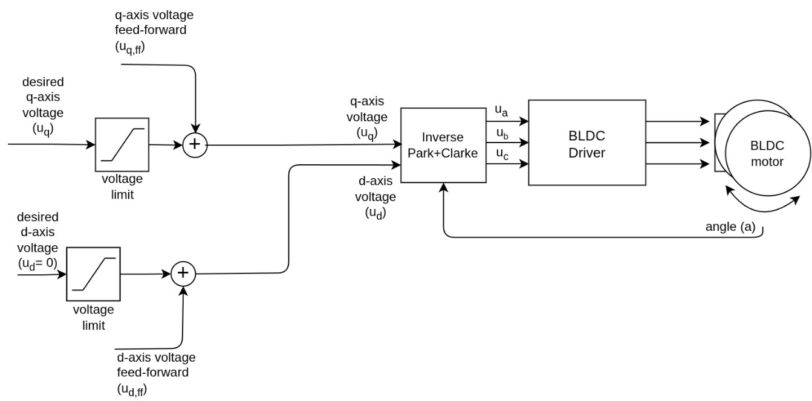</p>

### Başlangıç prosedürü

1. **AS5600 sağlık kontrolü.** `STATUS` (MD / ML / MH mıknatıs bitleri) ve `AGC` okunur. Mıknatıs algılanmazsa kritik hata oluşur ve sistem durur.
2. **MPU6050 yapılandırması.** Sensör uykudan çıkarılır, DLPF 42 Hz'e ve jiroskop aralığı ±2000 °/s'ye ayarlanır.
3. **D-ekseni hizalaması.** 1 s boyunca `Ud = 8 V, Uq = 0` uygulanarak rotor d-eksenine kilitlenir. Bu sırada okunan enkoder değeri elektriksel sıfır olarak kaydedilir.
4. **Jiroskop DC offset kalibrasyonu.** Döngü içinde ilk 500 jiroskop örneğinin (0.5 s) ortalaması alınır. Bu işlem bitene kadar motor çıkışı bastırılır.
5. **Yumuşak başlangıç.** Platform açısı ivmeölçerden başlatılır, böylece motor devreye girerken sıçrama yapmaz.

<p align="center">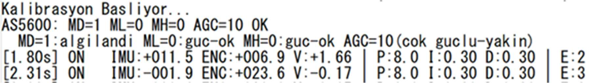</p>

### Hata yönetimi ve güvenlik

Hatalar, alt sisteme göre gruplanmış 16-bit kodlarla tanımlanır. Her kodun bir önem seviyesi vardır ve sistemin tepkisini bu seviye belirler:

| Kod | Olay | Seviye → tepki |
|---|---|---|
| `0x0101` | IMU I²C okuma hatası | **Kritik** → jiroskop hızı sıfırlanır, I²C1 resetlenir, güvenli kapatma, MCU reset ve yeniden kalibrasyon |
| `0x0201` | Enkoder I²C okuma hatası | Küçük → son geçerli açı korunur, I²C2 yazılımsal reset + yeniden başlatma |
| `0x0202` | AS5600'da mıknatıs yok | **Kritik** → güvenli kapatma + MCU reset |
| `0x0301` | Rotor ±170° sınırının dışında | Orantılı geri getirme gerilimi (170°/155° histerezis) |
| `0x0302` | Kilitli rotor (500 ms boyunca >4 V ve <0.05 rad hareket) | En fazla 5 kurtarma denemesi, ardından motor kapatılır |
| `0x0303` | Süreklilik gösteren gerilim doyumu | Loglanır |
| `0x0401` | Kontrol döngüsü deadline aşımı (dt > 20 ms) | Loglanır |
| `0x0402` | İntegral windup | Loglanır (histerezisli) |
| `0x0501` | Enkoder kalibrasyon hatası (>100 deneme) | **Kritik** → güvenli kapatma + MCU reset |

Kritik hatalarda `Sys_Safe_Shutdown()` çağrılır: motor sürücü devre dışı kalır ve PWM sıfırlanır. Ardından gevşek bir sensörün yeniden takılabilmesi için 250 ms beklenir ve MCU resetlenir. Reset sonrası başlangıç kalibrasyonu yeniden çalışır.

Enkoder yolunda ayrıca **aykırı değer reddi** vardır: 1 ms içinde 0.2 rad'dan büyük bir sıçrama fiziksel olarak mümkün olmadığı için EMI kaynaklı gürültü kabul edilir ve atılır.

---

## Derleme ve Yükleme

**Gereksinimler**

- Keil MDK / µVision 5 (ARM Compiler 6)
- `Keil::STM32F4xx_DFP` cihaz paketi (CMSIS çekirdeği ve STM32F407VGTx startup dosyalarını sağlar)
- ST-LINK (STM32F4-Discovery üzerinde dahili olarak bulunur)

**Adımlar**

1. `firmware/final_controller.uvprojx` dosyasını µVision ile açın.
2. İstenirse eksik STM32F4xx_DFP paketini Pack Installer üzerinden kurun.
3. **Build** (F7), ardından **Download** (F8) ile karta yükleyin.
4. Sürücü kartını **12 V** (motor) ve **3.3 V** (lojik) ile besleyin.

> ⚠️ `main.c` içindeki `sensor_direction` ve `pid_direction` değerleri faz kablolamasına ve mekanik montaja bağlıdır. Rotor dönmek yerine kilitleniyorsa `sensor_direction` işaretini değiştirin.

---

## Kullanım: telemetri ve canlı ayar

**PA2/PA3**'e bir USB-UART dönüştürücü bağlayın ve terminali **115200 8N1** ayarıyla açın. Durum satırı 2 Hz'de basılır:

```
[16.85s] ON   IMU:-000.6 ENC:-023.4 V:-0.19 | P:8.0 I:0.30 D:0.30 | E:3
          │    │          │          │        └─ canlı PID kazançları └─ aktif hata türü sayısı
          │    │          │          └─ uygulanan Vq (V)
          │    │          └─ rotor mekanik açısı (°)
          │    └─ füzyon sonrası platform açısı (°)
          └─ CAL / ON / OFF
```

Hata varsa her 5 saniyede bir hata tablosu (kod, açıklama, adet, son zaman damgası) basılır.

**Yeniden derlemeden canlı PID ayarı:**

| Tuş | Etki | Tuş | Etki |
|---|---|---|---|
| `q` | Kp + 1 | `a` | Kp − 1 |
| `w` | Ki + 0.1 | `s` | Ki − 0.1 |
| `e` | Kd + 0.1 | `d` | Kd − 0.1 |

**Mavi kullanıcı butonu (PA0)** motoru açıp kapatır.

---

## Sonuçlar

| Ölçüt | Sonuç |
|---|---|
| Başlangıç sonrası yerleşme | ≈ 2.8 s (D-ekseni hizalama ve jiroskop kalibrasyonu dahil) |
| Kararlı durumda platform açısı | −0.9° … −2.1° (ortalama ≈ −1.5°), 0.02–0.20 V ile tutuluyor |
| Bozucu bastırma | Elle yapılan yer değiştirmelerden sonra platform referansa geri dönüyor |
| Döngü süresi (DWT) | 1000 µs periyot içinde min ~290 µs · tipik 320–350 µs · maks ~420 µs |
| PWM doğrulama | 20 kHz frekans, 3 faz simetrisi ve görev oranları lojik analizörle doğrulandı |

<p align="center">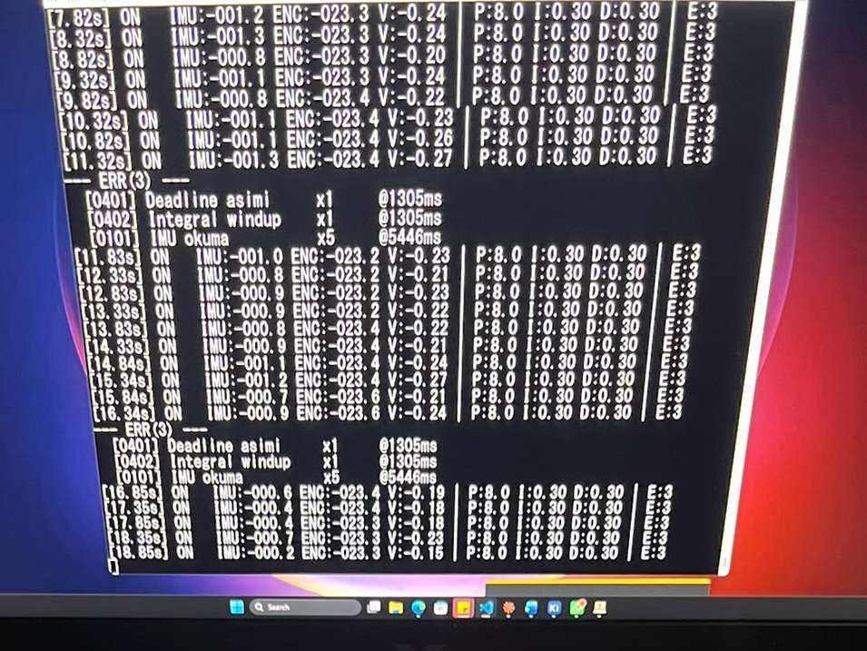</p>

Test yöntemi, PID ayar tabloları (Kp/Ki/Kd taramaları), WCET analizi ve EMI tartışmasının tamamı [raporun](docs/final_raporu.pdf) 4. bölümündedir.

---

## Bilinen Kısıtlamalar ve Gelecek Çalışmalar

- **Akım geri beslemeli FOC.** Rev1 kartında INA240A2 akım algılama kanalları bulunuyor, ancak bu kanallar gereken doğruluğa ulaşamadı. Bu nedenle tasarım gerilim-modlu FOC'a dönüştürüldü. Sonraki kart revizyonunda INA240 referans bağlantıları ve diferansiyel ölçüm yapısı yeniden düzenlenerek kapalı çevrim `Id/Iq` kontrolüne geçilecek.
- **I²C hatlarında EMI.** Sensörler, 20 kHz'de anahtarlanan faz kablolarının yakınından geçen yalıtımsız jumper kablolarla bağlandığı için zaman zaman I²C hataları oluştu. Bu hatalar yazılımda yönetiliyor, ancak asıl çözüm ayrı bir sensör kartı ya da kablo demeti ve gerekirse daha hızlı veya diferansiyel bir arayüz.
- **Polling ile I²C okuma.** AS5600, zayıf pull-up dirençleri nedeniyle 100 kHz'de çalışıyor ve her iki sensör de polling ile okunuyor. Kesme veya DMA tabanlı okuma, döngüde zaman kazandırır.
- **Daha iyi sensörler**, **kompakt entegre kart** (MCU'nun da aynı PCB'de olduğu) ve **çok eksenli** (pitch/roll/yaw) genişleme.

---

## Depo yapısı

```
.
├── firmware/          Keil µVision projesi ve C kaynak kodları
├── hardware/
│   └── kicad/         KiCad şematik, PCB ve yerel kütüphaneler
├── docs/
│   ├── final_raporu.pdf   Bitirme projesi raporu
│   └── images/
├── LICENSE
└── README.md
```

---

## Yazar

**Melih Kutay İbrahim Kaya**, Elektrik-Elektronik Mühendisliği, İstanbul Arel Üniversitesi
Danışman: Doç. Dr. Ömer Işık

## Lisans

[MIT Lisansı](LICENSE) ile yayınlanmıştır.
